```{css, echo=FALSE}
#TOC::before {
  content: "Contenido";
  display: block;
  font-weight: bold;
  font-size: 1.3em;
  margin-bottom: 8px;
}
```

```{r, echo=FALSE}
htmltools::tags$script(htmltools::HTML(sprintf(
  "document.addEventListener('DOMContentLoaded', function(){var h=document.getElementById('header'); var i=document.createElement('img'); i.src='%s'; i.style.width='300px'; i.style.display='block'; i.style.marginBottom='15px'; h.insertBefore(i, h.firstChild);});",
  knitr::image_uri("logo_egade.png"))))
```

# Introducción

Para la elaboración de esta tarea y actividades, el equipo utilizó como base las realizadas anteriormente de forma individual por Daniel Mondragón, adaptándolas a los requerimientos de la Actividad Tarea 4. Los modelos previos son los siguientes:

| Entrega | Modelos (variable dependiente ~ independientes) | Datos |
|---|---|---|
| Tarea 2 | mt101 / mt101b: XOM ~ CVX, COP, XLE (mt101b excluye XLE); mt102: JPM ~ BAC, GS, TLT; mt103: AAPL ~ MSFT, NVDA, SPY | Diarios, 3 ene 2023 – 2 oct 2026 |
| Actividad 3 | Mismos modelos de la Tarea 2 | LSEG, 1 y 5 minutos, sesiones del 5 y 6 oct 2026 |
| Tarea 3 | mt301 / mt301b: XOM ~ CVX, COP, XLE, USO, SPY (el final excluye XLE); mt302: JPM ~ BAC, GS, TLT, C, SPY; mt303: AAPL ~ MSFT, NVDA, SPY, TSM, TLT | LSEG, 30 minutos, 1 jul – 7 oct 2026 |

En esta Actividad Tarea 4 se estiman ocho regresiones lineales simples (cada acción contra el S&P 500, es decir, su beta) y la matriz de correlación de las ocho acciones más el índice. Las acciones son AAPL, MSFT y NVDA (tecnología), JPM y GS (financiero), XOM y CVX (energía) y USO (ETF de petróleo). Los resultados se obtienen en Bloomberg (HRA y CORR, datos diarios del 2 ene 2025 al 12 oct 2026) y se replican en RStudio con datos de LSEG para cotejarlos. Como complemento, se repite el análisis con datos de 30 minutos de LSEG (1 jul – 12 oct 2026) para mostrar el efecto de la frecuencia.

De acuerdo con esta Actividad Tarea 4, se presentarán los screenshots de las operaciones de HowMarketsWork de las acciones seleccionadas en Bloomberg para cada uno de los alumnos del equipo (Parte 4).

# Parte 1. Datos, periodo y frecuencia

En esta parte se definen los datos con los que se trabaja en toda la actividad. Se utilizan los precios de cierre diarios de las ocho acciones seleccionadas (AAPL, MSFT, NVDA, JPM, GS, XOM, CVX y USO) y del índice S&P 500 (SPX), del 2 de enero de 2025 al 12 de octubre de 2026. Los mismos activos y el mismo periodo se consultaron en Bloomberg (funciones HRA y CORR) y se descargaron de LSEG Workspace para replicar los cálculos en RStudio, de modo que ambos resultados puedan cotejarse. Primero se preparan los precios y se calculan los rendimientos diarios, y después se justifica la elección de la frecuencia diaria.

## 1.1 Descarga y preparación de los datos

Los precios de LSEG se leen desde el archivo de Excel del equipo. Antes de calcular los rendimientos se verifica que las nueve series tengan exactamente las mismas fechas, porque cada fila debe comparar el mismo día entre activos. Después se calcula, para cada activo, el rendimiento diario en porcentaje como el cambio porcentual simple entre cierres consecutivos:

$$R_t = \left(\frac{P_t}{P_{t-1}} - 1\right) \times 100$$

El primer día de la muestra no tiene un cierre anterior, por lo que no tiene rendimiento y se elimina: de 445 precios resultan 444 rendimientos por activo. El resultado es la tabla `rend`, con una columna por activo y una fila por día, que se utiliza en todas las partes siguientes. Este es el mismo cálculo que realiza Bloomberg cuando se selecciona la opción *Percent*.

**Lectura de los precios y verificación de fechas.**

```{r datos-diarios, message=FALSE, warning=FALSE}
library(readxl)
library(quantmod)

# 1. Leer la hoja de valores de LSEG
precios <- read_excel("Tarea4_Grupo1_datosLSEG.xlsx", sheet = "diario_valores")

# 2. Columnas de fecha y de precio de cada activo (cada uno ocupa 3 columnas)
nombres   <- c("AAPL", "MSFT", "XOM", "JPM", "USO", "NVDA", "CVX", "GS", "SPX")
col_fecha <- c(1, 4, 7, 10, 13, 16, 19, 22, 25)
col_close <- col_fecha + 1

# 3. Verificar que las 9 series tengan exactamente las mismas fechas
fechas <- as.Date(precios[[1]])
mismas_fechas <- all(sapply(col_fecha, function(j) all(as.Date(precios[[j]]) == fechas)))
mismas_fechas
```

El resultado `TRUE` confirma que las nueve series comparten exactamente las mismas fechas.

**Cálculo de los rendimientos diarios.**

```{r rendimientos-diarios}
# 4. Tabla limpia de precios: una fecha y una columna por activo
px <- data.frame(Fecha = fechas)
for (i in seq_along(nombres)) px[[nombres[i]]] <- precios[[col_close[i]]]

# 5. Rendimientos diarios en % (cambio porcentual simple)
rend <- px
for (a in nombres) rend[[a]] <- ROC(px[[a]], type = "discrete") * 100
rend <- na.omit(rend)   # elimina la primera fila, que no tiene rendimiento
rownames(rend) <- NULL

knitr::kable(data.frame(
  Concepto = c("Primera fecha", "Última fecha", "Precios por activo", "Rendimientos por activo"),
  Valor    = c(format(min(px$Fecha)), format(max(px$Fecha)), nrow(px), nrow(rend))),
  caption = "Resumen de los datos diarios")
```

La tabla confirma que se tienen 445 precios por activo, del 2 de enero de 2025 al 12 de octubre de 2026, y que se obtienen 444 rendimientos diarios por activo.

**Primeros y últimos rendimientos.** La siguiente tabla muestra los tres primeros y los tres últimos rendimientos diarios (en %) de la tabla `rend`.

```{r muestra-rend}
knitr::kable(rbind(head(rend, 3), tail(rend, 3)), digits = 4, row.names = FALSE,
             caption = "Primeros y últimos rendimientos diarios (%)")
```

Como control adicional, dos rendimientos se recalcularon manualmente a partir de los precios y coincidieron con los de la tabla (por ejemplo, AAPL el 3 de enero de 2025: −0.20%; NVDA: +4.45%). Estos rendimientos son la base de las regresiones y de la matriz de correlación de las partes siguientes.

## 1.2 Justificación de la frecuencia y del periodo

La rúbrica no fija una frecuencia única para los datos, por lo que la elección debe justificarse. Se utilizan rendimientos **diarios** por las siguientes razones:

1. **Comparabilidad entre Bloomberg y LSEG.** El precio de cierre diario es el dato oficial de cada día de operación y es el mismo en ambos proveedores (por ejemplo, el último cierre de AAPL es 340.97 en los dos). Las barras intradía, en cambio, las construye cada proveedor con sus propias reglas de agregación y de horario, de modo que una diferencia en una regresión de minutos podría deberse al proveedor y no al modelo. Con datos diarios el cotejo entre Bloomberg y RStudio es limpio.
2. **Horizonte de la estrategia.** El portafolio se construye con un horizonte de varias semanas, no de operaciones intradía. La beta contra el S&P 500 que importa para esa decisión es la que describe cómo se mueve cada acción frente al mercado de un día a otro.
3. **Evidencia de la Actividad 3.** En esa actividad, con datos de 1 y 5 minutos, la autocorrelación de los residuos a 1 minuto desaparecía al pasar a 5 minutos. Esto es consistente con el efecto de microestructura del mercado (ruido de las operaciones y no sincronía entre activos, conocido como efecto Epps), que distorsiona las correlaciones a frecuencias muy altas. A frecuencia diaria ese problema es menor.
4. **Tamaño de la muestra.** El periodo produce 444 observaciones por serie, suficientes para estimar betas y correlaciones con precisión razonable.

El periodo (2 de enero de 2025 al 12 de octubre de 2026) es el mismo que se consultó en Bloomberg, para que ambos resultados sean comparables. Además, incluye un episodio de estrés muy marcado: las tres mayores caídas y la mayor alza diaria del S&P 500 en la muestra ocurren en abril de 2025, en el contexto de los anuncios arancelarios de Estados Unidos y su posterior pausa. Los días de mayor caída y de mayor alza son los siguientes:

```{r dias-extremos}
ord <- order(rend$SPX)
extremos <- rbind(
  cbind(Tipo = "Mayores caídas", rend[ord[1:3], c("Fecha", "SPX")]),
  cbind(Tipo = "Mayores alzas",  rend[rev(ord)[1:3], c("Fecha", "SPX")])
)
knitr::kable(extremos, digits = 2, row.names = FALSE,
             col.names = c("Tipo", "Fecha", "S&P 500 (%)"))
```

Incluir un periodo de alta volatilidad es deseable: la beta se estima observando cómo responde cada acción tanto en días tranquilos como en días de estrés. Sin embargo, tiene una consecuencia que se reconoce desde ahora: unos pocos días extremos concentrados en abril de 2025 pueden influir de forma importante en las betas y en las correlaciones estimadas, por lo que los resultados deben interpretarse con esa consideración presente.

Como complemento, y para ilustrar el efecto de la frecuencia, en la sección 3.11 se repite el análisis con datos de 30 minutos de LSEG (1 de julio al 12 de octubre de 2026). Ese análisis adicional no se coteja con Bloomberg.

# Parte 2. Matriz de correlación

En esta parte se analiza qué tanto se mueven juntos los rendimientos diarios de las ocho acciones y del S&P 500. El coeficiente de correlación va de −1 a 1: un valor cercano a 1 indica que dos activos tienden a subir y bajar al mismo tiempo, un valor cercano a 0 indica que sus movimientos no están relacionados, y un valor negativo indica que tienden a moverse en sentidos opuestos. La correlación es una medida descriptiva y sirve de antesala a las regresiones de la Parte 3: en una regresión simple, el R² es el cuadrado de la correlación entre la acción y el S&P 500. El procedimiento sigue el mismo orden que en el resto de la actividad: primero los resultados de Bloomberg, después la réplica en RStudio con los datos de LSEG, luego la comparación y por último los hallazgos.

## 2.1 Resultados en Bloomberg (CORR)

La matriz se obtuvo con la función CORR de Bloomberg (matriz guardada como "Correlación Tarea4"), con los mismos activos y el mismo periodo de la Parte 1 (2 de enero de 2025 al 12 de octubre de 2026). Primero se muestra cómo se configuró el cálculo y después la matriz resultante.

**Configuración del cálculo.** En la siguiente imagen se observa la pantalla de propiedades de la matriz. En la parte superior se definen el periodo (01/02/2025 a 10/12/2026), la frecuencia diaria (*Daily*), el tipo de cálculo (*Correlation*) y la moneda local (*Local CCY*). Debajo aparece una fila por cada activo con su identificador de Bloomberg (por ejemplo, *AAPL US Equity* para Apple y *SPX Index* para el S&P 500). En cada fila se indica que el cálculo usa el precio de cierre (*Last Price*), que la correlación se calcula sobre cambios porcentuales (*Percent*), es decir, sobre rendimientos y no sobre precios, que no se aplica transformación logarítmica (*Log: None*) y que no se usan promedios móviles ni rezagos (*MAvg* y *Lag* en 0). Esta configuración es equivalente a la de los rendimientos calculados en la Parte 1.

```{r captura-corr-config, echo=FALSE, out.width="90%"}
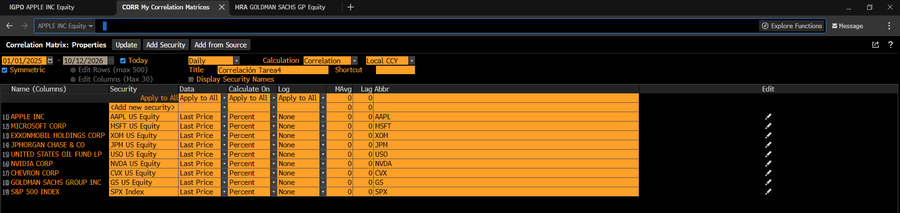
```

**Matriz resultante.** En la siguiente imagen se observa la matriz de correlación de 9 × 9 que entrega Bloomberg. Cada celda es la correlación entre los rendimientos diarios del activo de la fila y el de la columna. La diagonal es 1.000 porque cada activo está perfectamente correlacionado consigo mismo, y la matriz es simétrica (el valor AAPL–MSFT es el mismo que MSFT–AAPL). La última columna, SPX, es la más relevante para esta actividad: muestra la correlación de cada acción con el mercado, que en la Parte 3 se relaciona directamente con el R² de cada regresión.

```{r captura-corr-matriz, echo=FALSE, out.width="90%"}
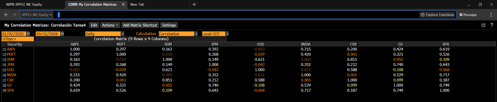
```

En la matriz destacan, por ejemplo, la correlación muy alta entre XOM y CVX (0.851), la de GS con el S&P 500 (0.749) y la de JPM con GS (0.740), así como correlaciones cercanas a cero entre las acciones de energía y las de tecnología. Estos valores se replican en RStudio en la siguiente sección y se interpretan en la sección de hallazgos.

## 2.2 Réplica en RStudio

Con los rendimientos diarios de la tabla `rend` (Parte 1) se calcula en RStudio la matriz de correlación de los mismos nueve activos. La función `cor()` calcula el coeficiente de correlación de Pearson entre cada par de columnas, que es la misma medida que utiliza Bloomberg. Los activos se ordenan igual que en la matriz de Bloomberg (AAPL, MSFT, XOM, JPM, USO, NVDA, CVX, GS y SPX) y los resultados se redondean a tres decimales, que es la precisión que muestra Bloomberg, para facilitar la comparación.

```{r correlacion-r}
# Matriz de correlación de los rendimientos diarios, en el orden de Bloomberg
orden_bbg <- c("AAPL", "MSFT", "XOM", "JPM", "USO", "NVDA", "CVX", "GS", "SPX")
corr_r <- cor(rend[, orden_bbg])

knitr::kable(round(corr_r, 3), digits = 3,
             caption = "Matriz de correlación en RStudio (rendimientos diarios, LSEG)")
```

En la tabla anterior se observa la matriz calculada en RStudio. Tiene la misma estructura que la de Bloomberg: es de 9 × 9, la diagonal es 1 y es simétrica. En la siguiente sección se comparan ambas matrices.

## 2.3 Comparación Bloomberg vs. RStudio

Para cotejar ambos resultados de forma objetiva, la matriz de Bloomberg se captura en R a partir de la imagen de la sección 2.1 y se resta, celda por celda, de la matriz calculada en RStudio (redondeada a tres decimales, la misma precisión que muestra Bloomberg). Si ambos cálculos coinciden, todas las diferencias deben ser cero.

**Captura de la matriz de Bloomberg.** Primero se teclean los valores de la imagen en el mismo orden de activos. Como control contra errores de captura, se verifica que la matriz sea simétrica; si algún valor se hubiera tecleado mal, el resultado sería `FALSE`.

```{r captura-bbg-corr}
corr_bbg <- matrix(c(
   1.000,  0.297,  0.163,  0.392, -0.003,  0.315,  0.200,  0.424,  0.619,
   0.297,  1.000, -0.010,  0.268, -0.039,  0.420,  0.061,  0.321,  0.526,
   0.163, -0.010,  1.000,  0.149,  0.621,  0.005,  0.851,  0.055,  0.109,
   0.392,  0.268,  0.149,  1.000, -0.042,  0.352,  0.212,  0.740,  0.643,
  -0.003, -0.039,  0.621, -0.042,  1.000,  0.011,  0.588, -0.108, -0.068,
   0.315,  0.420,  0.005,  0.352,  0.011,  1.000,  0.065,  0.529,  0.717,
   0.200,  0.061,  0.851,  0.212,  0.588,  0.065,  1.000,  0.099,  0.187,
   0.424,  0.321,  0.055,  0.740, -0.108,  0.529,  0.099,  1.000,  0.749,
   0.619,  0.526,  0.109,  0.643, -0.068,  0.717,  0.187,  0.749,  1.000),
  nrow = 9, byrow = TRUE, dimnames = list(orden_bbg, orden_bbg))

isSymmetric(corr_bbg)
```

El resultado `TRUE` confirma que la matriz se capturó correctamente.

**Diferencias celda por celda.** La siguiente tabla muestra, para cada par de activos, la correlación de RStudio menos la de Bloomberg.

```{r tabla-dif-corr}
dif_corr <- round(round(corr_r, 3) - corr_bbg, 3)

knitr::kable(dif_corr, digits = 3,
             caption = "Diferencia RStudio − Bloomberg (correlaciones)")
```

En la tabla se observa que todas las diferencias son cero.

**Resumen del cotejo.**

```{r resumen-cotejo-corr}
resumen_corr <- data.frame(
  Concepto = c("Celdas comparadas", "Celdas que coinciden", "Diferencia máxima (valor absoluto)"),
  Valor    = c(length(dif_corr), sum(dif_corr == 0), max(abs(dif_corr)))
)
knitr::kable(resumen_corr, caption = "Resumen del cotejo de correlaciones")
```

**Resultado de la comparación:** las 81 celdas de la matriz calculada en RStudio con datos de LSEG coinciden exactamente con las de Bloomberg a tres decimales. Esto confirma que ambos proveedores reportan los mismos precios de cierre diarios y que el cálculo de rendimientos y correlaciones es equivalente en las dos herramientas. La única limitación de este cotejo es la precisión: Bloomberg muestra tres decimales, por lo que no es posible comparar diferencias más pequeñas.

## 2.4 Hallazgos

Una vez confirmado que Bloomberg y RStudio producen la misma matriz, los resultados se interpretan en cuatro puntos.

**1. Los activos se agrupan por sector.** Las correlaciones más altas de la matriz se dan entre activos del mismo sector. En energía, XOM y CVX tienen una correlación de 0.851, y ambas se relacionan de forma importante con el ETF de petróleo USO (0.621 y 0.588). En el sector financiero, JPM y GS tienen una correlación de 0.740. En tecnología la relación es más moderada: MSFT–NVDA (0.420), AAPL–NVDA (0.315) y AAPL–MSFT (0.297), lo que indica que, en este periodo, cada empresa tecnológica tuvo un comportamiento más propio que las del sector financiero o energético.

**2. La relación con el mercado es muy distinta entre sectores.** En la columna del S&P 500, las acciones financieras y tecnológicas muestran correlaciones de moderadas a altas: GS (0.749), NVDA (0.717), JPM (0.643), AAPL (0.619) y MSFT (0.526). En cambio, las de energía casi no se relacionan con el mercado: CVX (0.187), XOM (0.109) y USO (−0.068). Esto anticipa los resultados de la Parte 3, ya que el R² de cada regresión es el cuadrado de estos valores (por ejemplo, para GS, 0.749² ≈ 0.56).

**3. Energía y tecnología se mueven casi de forma independiente.** Las correlaciones entre las acciones de energía y las tecnológicas son prácticamente cero (XOM–MSFT: −0.010; XOM–NVDA: 0.005; USO–AAPL: −0.003), y la de USO con GS es incluso ligeramente negativa (−0.108).

**4. Implicación para el portafolio.** El portafolio combina tecnología (AAPL, MSFT), finanzas (JPM) y energía (XOM, USO). Por los puntos anteriores, las posiciones en energía aportan diversificación frente al resto del portafolio y frente al mercado, ya que sus rendimientos casi no se mueven con los de las otras acciones. Sin embargo, XOM y USO están correlacionadas entre sí (0.621), por lo que dentro del bloque de energía la diversificación es menor de lo que sugiere tener dos posiciones distintas.

Dos consideraciones al interpretar estos resultados: la correlación mide qué tanto se mueven juntos dos activos, pero no implica que uno cause el movimiento del otro; y, como se señaló en la sección 1.2, los días extremos de abril de 2025 pueden influir en las correlaciones estimadas para todo el periodo.

# Parte 3. Regresiones lineales simples contra el S&P 500

En esta parte se estima, para cada una de las ocho acciones, una regresión lineal simple de su rendimiento diario contra el rendimiento diario del S&P 500:

$$R_{activo,t} = \alpha + \beta \, R_{SPX,t} + \varepsilon_t$$

La pendiente $\beta$ (beta) mide cuánto se mueve la acción, en promedio, por cada 1% que se mueve el mercado: una beta mayor a 1 indica que la acción amplifica los movimientos del mercado, y una menor a 1 que los atenúa. El intercepto $\alpha$ es el rendimiento diario promedio que no explica el mercado, y el $R^2$ indica qué proporción de la variación de la acción explica el mercado. La actividad solicita regresiones lineales simples, que son las que estima la función HRA de Bloomberg, lo que permite cotejarlas con RStudio. Se sigue el mismo orden que en la Parte 2: resultados de Bloomberg, réplica en RStudio, comparación y hallazgos.

## 3.1 Presentación de cada regresión

Para cada acción se presenta, en su propia sección, la regresión obtenida en la terminal de Bloomberg, su réplica en RStudio y una tabla que compara ambos resultados. Lo que es común a todas se explica aquí una sola vez.

**Lectura de la pantalla HRA de Bloomberg.** Las regresiones se obtuvieron con la función *Historical Regression Analysis* (HRA). Todas las capturas tienen la misma estructura:

- **Configuración (parte superior).** La variable dependiente (*Dep*) es la acción y la independiente (*Indep*) es el índice S&P 500 (*SPX Index*). Se usa el precio de cierre (*Last Price*), con frecuencia diaria (*Daily*), regresión lineal (*Linear*) sobre cambios porcentuales (*Reg On Percent*) y el periodo del 01/02/2025 al 10/12/2026, sin rezagos (*Lag* 0). Es la misma configuración de la matriz de correlación de la Parte 2.
- **Gráfica de dispersión (centro).** Cada punto es un día: en el eje horizontal el rendimiento del S&P 500 y en el vertical el de la acción. La línea roja es la recta de regresión, cuya ecuación aparece en el recuadro superior izquierdo. En todas las gráficas se distingue un punto aislado en el extremo derecho, que corresponde al 9 de abril de 2025, cuando el S&P 500 subió 9.52% (sección 1.2).
- **Estadísticos (panel derecho).** Bloomberg reporta la beta cruda (*Raw BETA*), la beta ajustada (*Adjusted BETA*), el intercepto (*ALPHA*), el $R^2$, la correlación (*R*), los errores estándar de alfa y beta, el estadístico t de la beta (*t-Test*), su valor p (*Significance*) y el número de observaciones (*Number of Points*).
- **Gráfica de precios (parte inferior).** Muestra la evolución del precio de la acción (línea blanca) y del S&P 500 (línea naranja) durante el periodo.

**Estimación de las ocho regresiones en RStudio.** Con los rendimientos diarios (no los precios) de la tabla `rend` creada en la Parte 1, se estiman de una sola vez las ocho regresiones con la función `lm()`, que ajusta una regresión lineal por mínimos cuadrados ordinarios. Los modelos se nombran mt401 a mt408, siguiendo la convención de las tareas anteriores. Sus resultados se presentan en la sección de cada acción.

```{r modelos-401-408}
mt401 <- lm(AAPL ~ SPX, data = rend)
mt402 <- lm(MSFT ~ SPX, data = rend)
mt403 <- lm(NVDA ~ SPX, data = rend)
mt404 <- lm(JPM  ~ SPX, data = rend)
mt405 <- lm(GS   ~ SPX, data = rend)
mt406 <- lm(XOM  ~ SPX, data = rend)
mt407 <- lm(CVX  ~ SPX, data = rend)
mt408 <- lm(USO  ~ SPX, data = rend)
```

**Función de cotejo.** Se crea una función que recibe un modelo de RStudio y los valores que muestra la captura de Bloomberg para esa acción. La función redondea los resultados de RStudio a tres decimales (la precisión de Bloomberg) y los presenta junto a los de Bloomberg con su diferencia. La beta ajustada se calcula con la fórmula de Bloomberg, $\beta_{ajustada} = \tfrac{2}{3}\beta + \tfrac{1}{3}$, que acerca la beta estimada a 1 bajo el supuesto de que, con el tiempo, las betas tienden hacia la del mercado.

```{r funcion-cotejo}
fmt <- function(v) ifelse(abs(v) >= 100, sprintf("%.0f", v), sprintf("%.3f", v))

cotejo_reg <- function(modelo, bbg, titulo) {
  s  <- summary(modelo)
  cf <- coef(s)
  r  <- c(cf[2, 1], 2/3 * cf[2, 1] + 1/3, cf[1, 1], s$r.squared,
          cf[1, 2], cf[2, 2], cf[2, 3], cf[2, 4], nobs(modelo))
  tabla <- data.frame(
    Estadistico = c("Beta cruda", "Beta ajustada", "Alfa (intercepto)", "R²",
                    "Error estándar de alfa", "Error estándar de beta",
                    "Estadístico t de beta", "Valor p de beta", "Observaciones"),
    Bloomberg  = fmt(bbg),
    RStudio    = fmt(round(r, 3)),
    Diferencia = fmt(round(round(r, 3) - bbg, 3)))
  knitr::kable(tabla, row.names = FALSE, caption = titulo,
               col.names = c("Estadístico", "Bloomberg", "RStudio", "Diferencia"),
               align = c("l", "r", "r", "r"))
}
```

Si alguna diferencia es de ±0.001, se debe al redondeo a tres decimales de un mismo valor y no a una diferencia en los datos: como se mostró en la Parte 2, ambos proveedores reportan los mismos precios.

**Función de gráfica.** Para que el lector pueda comparar visualmente ambas regresiones, se crea una función que reproduce en RStudio la gráfica de dispersión de Bloomberg: cada punto es un día (rendimiento del S&P 500 en el eje horizontal y de la acción en el vertical), la línea roja es la recta estimada y su ecuación aparece en la esquina superior izquierda. La función toma los datos directamente del modelo, por lo que grafica exactamente los rendimientos que se usaron en la regresión.

```{r funcion-grafica}
grafica_reg <- function(modelo, activo) {
  x <- modelo$model$SPX
  y <- modelo$model[[1]]
  b <- coef(modelo)
  plot(x, y, pch = 18, col = "darkorange",
       xlab = "Rendimiento diario del S&P 500 (%)",
       ylab = paste("Rendimiento diario de", activo, "(%)"),
       main = paste("Regresión", activo, "vs. S&P 500 (RStudio)"))
  abline(h = 0, v = 0, col = "gray70", lty = 2)
  abline(modelo, col = "red", lwd = 2)
  legend("topleft", legend = sprintf("Y = %.3f X + %.3f", b[2], b[1]),
         col = "red", lwd = 2, bty = "n")
}
```

## 3.2 Apple (AAPL) vs. S&P 500

En la siguiente imagen se observa la regresión de AAPL contra el S&P 500 en la terminal de Bloomberg.

```{r hra-aapl, echo=FALSE, out.width="95%"}
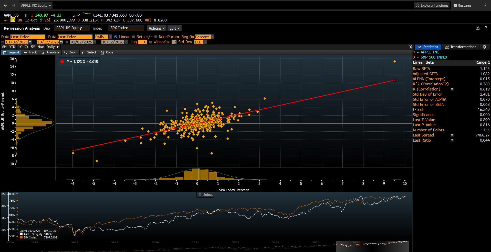
```

La recta estimada es *Y = 1.123 X + 0.015*. La beta cruda de 1.123 indica que, por cada 1% que se mueve el S&P 500, AAPL se mueve en promedio 1.12%: amplifica ligeramente los movimientos del mercado. El $R^2$ es 0.383, es decir, el mercado explica alrededor del 38% de la variación diaria de AAPL, y el estadístico t (16.569) indica que la beta es estadísticamente significativa.

La misma regresión estimada en RStudio (modelo mt401) se muestra en la siguiente gráfica:

```{r grafica-mt401, fig.width=8, fig.height=5}
grafica_reg(mt401, "AAPL")
```

La gráfica de RStudio reproduce la de Bloomberg: la nube de puntos tiene la misma forma, la recta tiene la misma pendiente y aparece el mismo punto aislado del 9 de abril de 2025 en el extremo derecho. El resultado numérico completo del modelo es el siguiente:

```{r summary-mt401}
summary(mt401)
```

La siguiente tabla compara ambos resultados. Los valores de Bloomberg se toman del panel derecho de la captura, en el orden de la tabla:

```{r cotejo-aapl}
cotejo_reg(mt401,
           bbg = c(1.123, 1.082, 0.015, 0.383, 0.070, 0.068, 16.569, 0.000, 444),
           titulo = "Cotejo de la regresión AAPL vs. S&P 500")
```

**Resultado de la comparación:** los resultados de RStudio coinciden con los de Bloomberg en todos los estadísticos a tres decimales: la beta, el intercepto, el $R^2$, los errores estándar, el estadístico t y el número de observaciones son los mismos. La réplica confirma la regresión de Bloomberg.

## 3.3 Microsoft (MSFT) vs. S&P 500

En la siguiente imagen se observa la regresión de MSFT contra el S&P 500 en la terminal de Bloomberg.

```{r hra-msft, echo=FALSE, out.width="95%"}
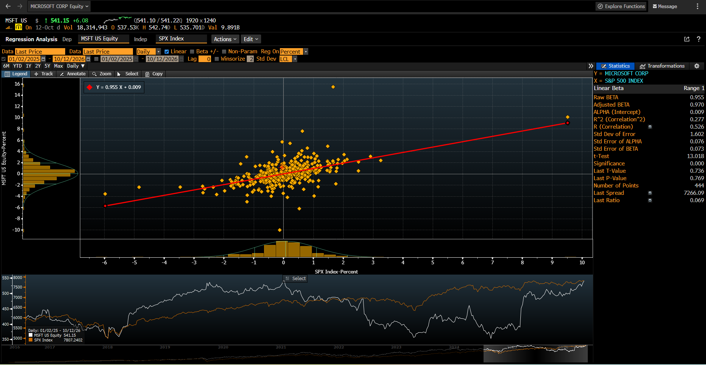
```

La recta estimada es *Y = 0.955 X + 0.009*. La beta cruda de 0.955 indica que MSFT se mueve prácticamente al mismo ritmo que el mercado. El $R^2$ es 0.277, el más bajo entre las acciones tecnológicas y financieras, y el estadístico t (13.018) indica que la beta es estadísticamente significativa. En la gráfica destaca un punto en la parte superior: el 30 de julio de 2026 MSFT subió 15.51% mientras el S&P 500 subió 1.66%, un movimiento propio de la acción que la regresión no puede explicar.

La misma regresión estimada en RStudio (modelo mt402) se muestra en la siguiente gráfica:

```{r grafica-mt402, fig.width=8, fig.height=5}
grafica_reg(mt402, "MSFT")
```

La gráfica de RStudio reproduce la de Bloomberg, incluido el punto del 30 de julio de 2026. El resultado numérico completo del modelo es el siguiente:

```{r summary-mt402}
summary(mt402)
```

La siguiente tabla compara ambos resultados:

```{r cotejo-msft}
cotejo_reg(mt402,
           bbg = c(0.955, 0.970, 0.009, 0.277, 0.076, 0.073, 13.018, 0.000, 444),
           titulo = "Cotejo de la regresión MSFT vs. S&P 500")
```

**Resultado de la comparación:** los resultados de RStudio coinciden con los de Bloomberg en todos los estadísticos a tres decimales. La réplica confirma la regresión de Bloomberg.

## 3.4 NVIDIA (NVDA) vs. S&P 500

En la siguiente imagen se observa la regresión de NVDA contra el S&P 500 en la terminal de Bloomberg.

```{r hra-nvda, echo=FALSE, out.width="95%"}
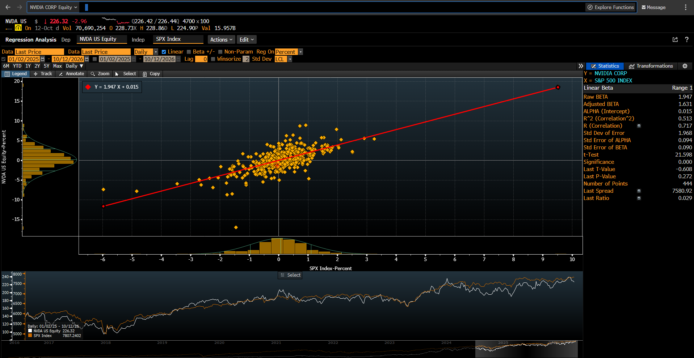
```

La recta estimada es *Y = 1.947 X + 0.015*. La beta cruda de 1.947 es la más alta de las ocho acciones: NVDA se mueve en promedio casi el doble que el mercado, lo que se aprecia en la pendiente pronunciada de la recta. El $R^2$ es 0.513, por lo que el mercado explica alrededor de la mitad de su variación diaria, y el estadístico t es 21.598.

La misma regresión estimada en RStudio (modelo mt403) se muestra en la siguiente gráfica:

```{r grafica-mt403, fig.width=8, fig.height=5}
grafica_reg(mt403, "NVDA")
```

La gráfica de RStudio reproduce la de Bloomberg, con la misma pendiente pronunciada. El resultado numérico completo del modelo es el siguiente:

```{r summary-mt403}
summary(mt403)
```

La siguiente tabla compara ambos resultados:

```{r cotejo-nvda}
cotejo_reg(mt403,
           bbg = c(1.947, 1.631, 0.015, 0.513, 0.094, 0.090, 21.598, 0.000, 444),
           titulo = "Cotejo de la regresión NVDA vs. S&P 500")
```

**Resultado de la comparación:** los resultados de RStudio coinciden con los de Bloomberg en todos los estadísticos a tres decimales. La réplica confirma la regresión de Bloomberg.

## 3.5 JPMorgan (JPM) vs. S&P 500

En la siguiente imagen se observa la regresión de JPM contra el S&P 500 en la terminal de Bloomberg.

```{r hra-jpm, echo=FALSE, out.width="95%"}
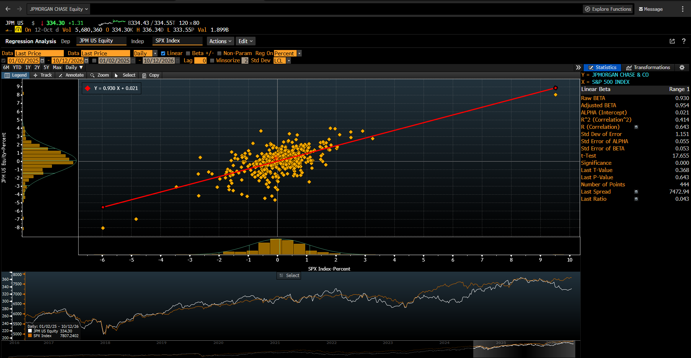
```

La recta estimada es *Y = 0.930 X + 0.021*. La beta cruda de 0.930 indica que JPM se mueve casi al mismo ritmo que el mercado, ligeramente por debajo. El $R^2$ es 0.414 y el estadístico t es 17.655.

La misma regresión estimada en RStudio (modelo mt404) se muestra en la siguiente gráfica:

```{r grafica-mt404, fig.width=8, fig.height=5}
grafica_reg(mt404, "JPM")
```

La gráfica de RStudio reproduce la de Bloomberg. El resultado numérico completo del modelo es el siguiente:

```{r summary-mt404}
summary(mt404)
```

La siguiente tabla compara ambos resultados:

```{r cotejo-jpm}
cotejo_reg(mt404,
           bbg = c(0.930, 0.954, 0.021, 0.414, 0.055, 0.053, 17.655, 0.000, 444),
           titulo = "Cotejo de la regresión JPM vs. S&P 500")
```

**Resultado de la comparación:** los resultados de RStudio coinciden con los de Bloomberg en todos los estadísticos a tres decimales. La réplica confirma la regresión de Bloomberg.

## 3.6 Goldman Sachs (GS) vs. S&P 500

En la siguiente imagen se observa la regresión de GS contra el S&P 500 en la terminal de Bloomberg.

```{r hra-gs, echo=FALSE, out.width="95%"}
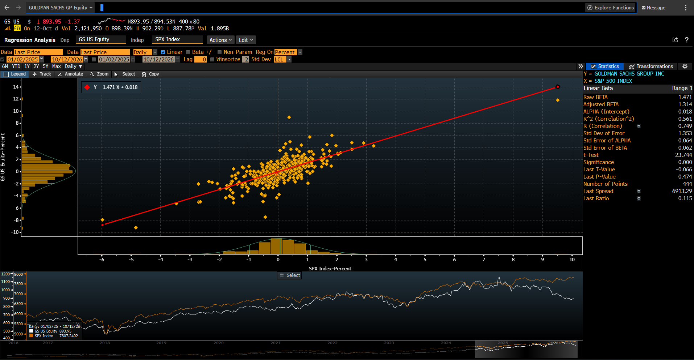
```

La recta estimada es *Y = 1.471 X + 0.018*. La beta cruda de 1.471 indica que GS amplifica los movimientos del mercado. El $R^2$ es 0.561, el más alto de las ocho acciones: los puntos se concentran alrededor de la recta, y el mercado explica más de la mitad de la variación diaria de GS. El estadístico t es 23.744.

La misma regresión estimada en RStudio (modelo mt405) se muestra en la siguiente gráfica:

```{r grafica-mt405, fig.width=8, fig.height=5}
grafica_reg(mt405, "GS")
```

La gráfica de RStudio reproduce la de Bloomberg, con los puntos concentrados alrededor de la recta. El resultado numérico completo del modelo es el siguiente:

```{r summary-mt405}
summary(mt405)
```

La siguiente tabla compara ambos resultados:

```{r cotejo-gs}
cotejo_reg(mt405,
           bbg = c(1.471, 1.314, 0.018, 0.561, 0.064, 0.062, 23.744, 0.000, 444),
           titulo = "Cotejo de la regresión GS vs. S&P 500")
```

**Resultado de la comparación:** los resultados de RStudio coinciden con los de Bloomberg en todos los estadísticos a tres decimales. La réplica confirma la regresión de Bloomberg.

## 3.7 Exxon Mobil (XOM) vs. S&P 500

En la siguiente imagen se observa la regresión de XOM contra el S&P 500 en la terminal de Bloomberg.

```{r hra-xom, echo=FALSE, out.width="95%"}
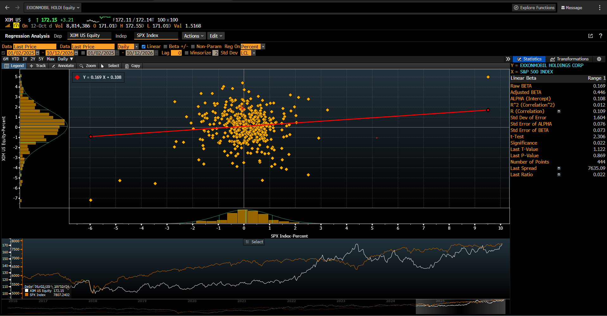
```

La recta estimada es *Y = 0.169 X + 0.108* y es casi horizontal. La beta cruda es 0.169 y el $R^2$ es apenas 0.012: los puntos forman una nube sin una dirección clara, y el mercado explica alrededor del 1% de la variación diaria de XOM. Aun así, la beta es estadísticamente distinta de cero al 5% (t = 2.306, valor p de 0.022).

La misma regresión estimada en RStudio (modelo mt406) se muestra en la siguiente gráfica:

```{r grafica-mt406, fig.width=8, fig.height=5}
grafica_reg(mt406, "XOM")
```

La gráfica de RStudio reproduce la de Bloomberg, con la misma recta casi horizontal. El resultado numérico completo del modelo es el siguiente:

```{r summary-mt406}
summary(mt406)
```

La siguiente tabla compara ambos resultados:

```{r cotejo-xom}
cotejo_reg(mt406,
           bbg = c(0.169, 0.446, 0.108, 0.012, 0.076, 0.073, 2.306, 0.022, 444),
           titulo = "Cotejo de la regresión XOM vs. S&P 500")
```

**Resultado de la comparación:** los resultados de RStudio coinciden con los de Bloomberg en todos los estadísticos a tres decimales. La réplica confirma la regresión de Bloomberg.

## 3.8 Chevron (CVX) vs. S&P 500

En la siguiente imagen se observa la regresión de CVX contra el S&P 500 en la terminal de Bloomberg.

```{r hra-cvx, echo=FALSE, out.width="95%"}
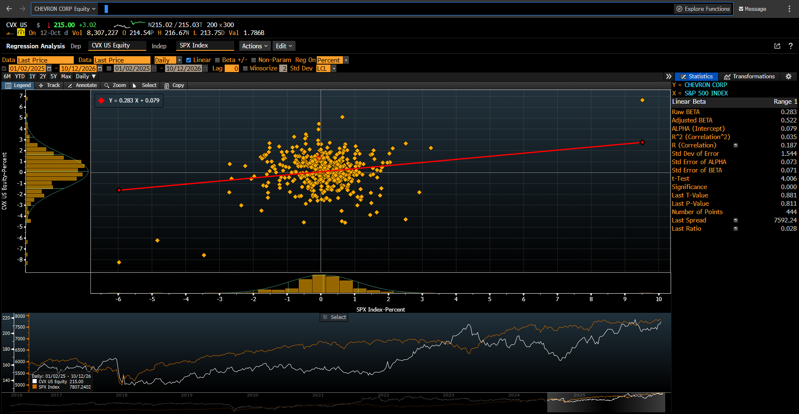
```

La recta estimada es *Y = 0.283 X + 0.079*. El comportamiento es similar al de XOM: la beta cruda es 0.283 y el $R^2$ es 0.035. La beta es estadísticamente significativa (t = 4.006), pero el mercado explica una proporción muy pequeña de la variación diaria de CVX.

La misma regresión estimada en RStudio (modelo mt407) se muestra en la siguiente gráfica:

```{r grafica-mt407, fig.width=8, fig.height=5}
grafica_reg(mt407, "CVX")
```

La gráfica de RStudio reproduce la de Bloomberg. El resultado numérico completo del modelo es el siguiente:

```{r summary-mt407}
summary(mt407)
```

La siguiente tabla compara ambos resultados:

```{r cotejo-cvx}
cotejo_reg(mt407,
           bbg = c(0.283, 0.522, 0.079, 0.035, 0.073, 0.071, 4.006, 0.000, 444),
           titulo = "Cotejo de la regresión CVX vs. S&P 500")
```

**Resultado de la comparación:** los resultados de RStudio coinciden con los de Bloomberg en todos los estadísticos a tres decimales. La réplica confirma la regresión de Bloomberg.

## 3.9 United States Oil Fund (USO) vs. S&P 500

En la siguiente imagen se observa la regresión de USO contra el S&P 500 en la terminal de Bloomberg.

```{r hra-uso, echo=FALSE, out.width="95%"}
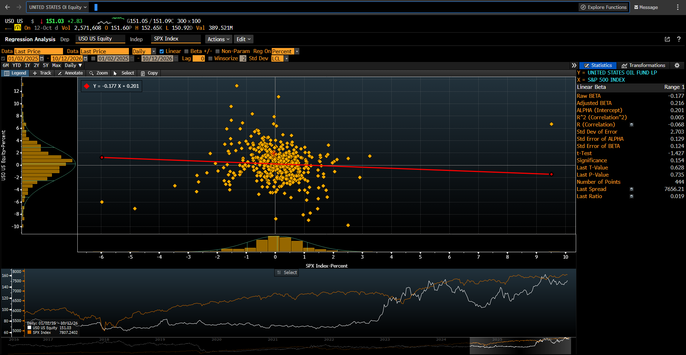
```

La recta estimada es *Y = −0.177 X + 0.201*. Es el único caso con beta negativa: la recta tiene una ligera pendiente descendente. Sin embargo, la beta no es estadísticamente significativa (t = −1.427, valor p de 0.154, mayor a 0.05) y el $R^2$ es 0.005, por lo que no puede concluirse que USO tenga una relación con el S&P 500 en este periodo.

La misma regresión estimada en RStudio (modelo mt408) se muestra en la siguiente gráfica:

```{r grafica-mt408, fig.width=8, fig.height=5}
grafica_reg(mt408, "USO")
```

La gráfica de RStudio reproduce la de Bloomberg, con la misma pendiente ligeramente negativa. El resultado numérico completo del modelo es el siguiente:

```{r summary-mt408}
summary(mt408)
```

La siguiente tabla compara ambos resultados:

```{r cotejo-uso}
cotejo_reg(mt408,
           bbg = c(-0.177, 0.216, 0.201, 0.005, 0.129, 0.124, -1.427, 0.154, 444),
           titulo = "Cotejo de la regresión USO vs. S&P 500")
```

**Resultado de la comparación:** los resultados de RStudio coinciden con los de Bloomberg en todos los estadísticos a tres decimales. La réplica confirma la regresión de Bloomberg.

## 3.10 Resumen y hallazgos

Una vez confirmado que las ocho regresiones de RStudio coinciden con las de Bloomberg, la siguiente tabla reúne los resultados principales de todas las acciones, ordenadas de mayor a menor beta, para compararlas entre sí. Se incluye también la correlación de cada acción con el S&P 500 de la Parte 2, para mostrar su relación con el $R^2$.

```{r resumen-regresiones}
mods <- list(AAPL = mt401, MSFT = mt402, NVDA = mt403, JPM = mt404,
             GS = mt405, XOM = mt406, CVX = mt407, USO = mt408)

resumen_reg <- do.call(rbind, lapply(names(mods), function(a) {
  cf <- coef(summary(mods[[a]]))
  data.frame(Activo  = a,
             Beta    = cf[2, 1],
             Beta_aj = 2/3 * cf[2, 1] + 1/3,
             R2      = summary(mods[[a]])$r.squared,
             t_beta  = cf[2, 3],
             p_beta  = cf[2, 4],
             Corr    = cor(rend[[a]], rend$SPX))
}))
resumen_reg <- resumen_reg[order(-resumen_reg$Beta), ]

knitr::kable(resumen_reg, digits = 3, row.names = FALSE,
             col.names = c("Activo", "Beta cruda", "Beta ajustada", "R²",
                           "t de beta", "Valor p", "Correlación con SPX"),
             caption = "Resumen de las ocho regresiones (ordenadas por beta)")
```

En la tabla se observa que el $R^2$ de cada regresión es el cuadrado de la correlación con el S&P 500 (por ejemplo, para GS, 0.749² ≈ 0.561), lo que conecta los resultados de la Parte 2 con los de esta parte. A partir de la tabla se identifican los siguientes hallazgos:

**1. Tres grupos de acciones según su beta contra el S&P 500.**

- **Betas altas:** NVDA (1.947) y GS (1.471) amplifican los movimientos del mercado, y AAPL (1.123) se mueve ligeramente más que el mercado. En los tres casos el mercado explica una parte importante de su variación diaria ($R^2$ de 0.383 a 0.561).
- **Betas cercanas a 1:** MSFT (0.955) y JPM (0.930) se mueven prácticamente al mismo ritmo que el mercado, con $R^2$ de 0.277 y 0.414.
- **Betas bajas y poder explicativo mínimo:** CVX (0.283), XOM (0.169) y USO (−0.177) casi no dependen del S&P 500 ($R^2$ de 0.035, 0.012 y 0.005). Las betas de CVX y XOM son estadísticamente distintas de cero al 5%, pero la de USO no (valor p de 0.154).

**2. Ningún intercepto es estadísticamente significativo.** En las ocho regresiones el alfa es pequeño y no es distinto de cero (por ejemplo, en AAPL su valor p es 0.833, como se observa en el resultado del modelo mt401). Es decir, en este periodo ninguna acción muestra un rendimiento diario sistemático adicional al que explica su relación con el mercado.

**3. Una beta baja no significa poco riesgo.** En las acciones de energía la beta es baja porque el S&P 500 explica muy poco de su comportamiento, no porque sus rendimientos sean estables. Su variación depende sobre todo de factores propios de la acción o del sector, que la regresión no captura. USO es el caso más claro: tiene la beta más baja, pero también la mayor desviación estándar del error de las ocho regresiones (2.703 en la captura de Bloomberg), es decir, la mayor variación no explicada por el mercado.

**4. Implicación para el portafolio.** El portafolio combina acciones con beta contra el S&P 500 cercana o superior a 1 (AAPL, MSFT y JPM) con posiciones de beta baja (XOM y USO). Estas últimas reducen la exposición del portafolio a los movimientos del mercado y aportan diversificación, en línea con las correlaciones de la Parte 2. Sin embargo, por el punto anterior, no reducen necesariamente el riesgo total: introducen un riesgo propio del sector energético, en particular del precio del petróleo.

Como se señaló en la sección 1.2, los días extremos de abril de 2025 pueden influir de forma importante en estas estimaciones, lo que se aprecia en el punto aislado del extremo derecho de todas las gráficas.

## 3.11 Complemento: regresiones y correlaciones con rendimientos intradía de 30 minutos (LSEG)

Como complemento, y para ilustrar el efecto de la frecuencia de los datos, se repiten las regresiones y la matriz de correlación con rendimientos **intradía de 30 minutos** descargados de LSEG Workspace para el periodo del 1 de julio al 12 de octubre de 2026. Estos resultados no se cotejan con Bloomberg, por las razones expuestas en la sección 1.2.

Para que la comparación sea válida hay que separar dos efectos: si se compararan directamente los rendimientos de 30 minutos (julio a octubre de 2026) con los diarios de la Parte 3 (enero de 2025 a octubre de 2026), cambiarían al mismo tiempo la frecuencia y el periodo, y no podría saberse cuál de los dos explica las diferencias. Por ello, cada regresión se estima en tres versiones:

1. **Diaria, periodo completo** (2 de enero de 2025 al 12 de octubre de 2026): los resultados de la Parte 3.
2. **Diaria, 1 de julio al 12 de octubre de 2026:** el mismo periodo que los datos intradía.
3. **Intradía de 30 minutos, 1 de julio al 12 de octubre de 2026.**

La comparación entre las versiones 2 y 3 muestra el efecto de la frecuencia, y la comparación entre las versiones 1 y 2, el efecto del periodo.

**Preparación de los datos intradía.** Los precios de 30 minutos se leen de la hoja `30min_valores` del archivo de Excel del equipo. Cada barra está identificada por la hora en que termina (hora de Nueva York): la primera del día es la de las 10:00 (de 9:30 a 10:00) y la última la de las 16:00, al cierre del mercado. Algunas series incluyen además barras de las 16:30, que corresponden a operaciones fuera del horario regular (*after-hours*); estas se eliminan para que todos los activos tengan las mismas barras. Después se calculan los rendimientos de 30 minutos con la misma fórmula de la Parte 1 y se elimina el primer rendimiento de cada día, porque compara el precio de las 10:00 con el cierre del día anterior: no es un rendimiento de 30 minutos, sino el de toda la noche.

```{r datos-30min, message=FALSE, warning=FALSE}
p30 <- read_excel("Tarea4_Grupo1_datosLSEG.xlsx", sheet = "30min_valores")

# Una tabla por activo con su hora y su precio, solo en horario regular (hasta las 16:00)
series30 <- lapply(seq_along(nombres), function(i) {
  df <- na.omit(data.frame(Hora = p30[[col_fecha[i]]], Precio = p30[[col_close[i]]]))
  df <- df[format(df$Hora, "%H:%M") <= "16:00", ]
  names(df)[2] <- nombres[i]
  df
})

# Unir los nueve activos por hora: solo quedan las barras comunes a todos
px30 <- Reduce(function(a, b) merge(a, b, by = "Hora"), series30)
px30 <- px30[order(px30$Hora), ]
dia30 <- as.Date(px30$Hora)

# Rendimientos de 30 minutos en %, sin el primer rendimiento de cada día
rend30 <- px30
for (a in nombres) rend30[[a]] <- ROC(px30[[a]], type = "discrete") * 100
rend30 <- rend30[c(FALSE, dia30[-1] == dia30[-length(dia30)]), ]
rownames(rend30) <- NULL

knitr::kable(data.frame(
  Concepto = c("Días de operación", "Barras de 30 minutos por día",
               "Precios por activo", "Rendimientos intradía por activo"),
  Valor = c(length(unique(dia30)), paste(unique(table(dia30)), collapse = ", "),
            nrow(px30), nrow(rend30))),
  caption = "Resumen de los datos intradía")
```

La tabla confirma que los nueve activos comparten las mismas 936 barras de horario regular (72 días de operación con 13 barras cada uno) y que, al eliminar el primer rendimiento de cada día, quedan 864 rendimientos de 30 minutos por activo.

**Regresiones en tres versiones.** Se estiman las mismas ocho regresiones simples contra el S&P 500 con los tres conjuntos de datos: los rendimientos diarios del periodo completo (tabla `rend`, 444 observaciones), los rendimientos diarios del 1 de julio al 12 de octubre de 2026 (72 observaciones) y los rendimientos de 30 minutos del mismo periodo (tabla `rend30`, 864 observaciones). Para no repetir código, se crea una función que estima la regresión de una acción con el conjunto de datos que se le indique y devuelve su beta y su $R^2$.

```{r regresiones-3-versiones}
# Rendimientos diarios del mismo periodo que los datos intradía
rend_jo <- rend[rend$Fecha >= as.Date("2026-07-01"), ]

activos <- c("AAPL", "MSFT", "NVDA", "JPM", "GS", "XOM", "CVX", "USO")

# Beta y R² de la regresión acción ~ SPX con el conjunto de datos indicado
estima <- function(datos, a) {
  m <- lm(reformulate("SPX", response = a), data = datos)
  c(Beta = unname(coef(m)[2]), R2 = summary(m)$r.squared)
}

res_d   <- t(sapply(activos, function(a) estima(rend,    a)))
res_djo <- t(sapply(activos, function(a) estima(rend_jo, a)))
res_30  <- t(sapply(activos, function(a) estima(rend30,  a)))
```

La siguiente tabla compara la beta contra el S&P 500 de cada acción en las tres versiones:

```{r tabla-betas-3}
knitr::kable(data.frame(Activo = activos,
                        D1 = res_d[, "Beta"], D2 = res_djo[, "Beta"], M30 = res_30[, "Beta"]),
             digits = 3, row.names = FALSE,
             col.names = c("Activo", "Diaria, ene 2025–oct 2026 (n = 444)",
                           "Diaria, jul–oct 2026 (n = 72)", "30 minutos, jul–oct 2026 (n = 864)"),
             caption = "Beta contra el S&P 500 según frecuencia y periodo")
```

**Efecto del periodo (diaria completa vs. diaria julio–octubre).** Con la misma frecuencia diaria, las betas cambian de forma importante al pasar del periodo completo al de julio a octubre de 2026. El caso más llamativo es el de energía: XOM, CVX y USO pasan de betas cercanas a cero a betas claramente negativas (−1.083, −0.936 y −2.647), es decir, en esos meses tendieron a moverse en sentido contrario al mercado. AAPL muestra el cambio opuesto: su beta cae de 1.123 a 0.091. En cambio, NVDA se mantiene prácticamente igual (1.947 y 1.940). Esto indica que la beta no es una característica fija de cada acción, sino que depende del periodo en que se estima. Debe considerarse, además, que con solo 72 observaciones las estimaciones de julio a octubre son menos precisas que las del periodo completo.

**Efecto de la frecuencia (diaria vs. 30 minutos, mismo periodo).** Con el mismo periodo, al pasar de datos diarios a datos de 30 minutos la mayoría de las betas se acercan a cero: MSFT pasa de 1.781 a 0.979, GS de 2.099 a 1.434, JPM de 0.828 a 0.622, y las betas negativas de energía se reducen considerablemente (XOM de −1.083 a −0.285, CVX de −0.936 a −0.253 y USO de −2.647 a −1.074). Las excepciones son NVDA, que se mantiene cerca de 2, y AAPL, cuya beta sube de 0.091 a 0.705.

La siguiente tabla compara el $R^2$ de cada regresión en las tres versiones:

```{r tabla-r2-3}
knitr::kable(data.frame(Activo = activos,
                        D1 = res_d[, "R2"], D2 = res_djo[, "R2"], M30 = res_30[, "R2"]),
             digits = 3, row.names = FALSE,
             col.names = c("Activo", "Diaria, ene 2025–oct 2026 (n = 444)",
                           "Diaria, jul–oct 2026 (n = 72)", "30 minutos, jul–oct 2026 (n = 864)"),
             caption = "R² contra el S&P 500 según frecuencia y periodo")
```

En la tabla se observa que, en el mismo periodo, el $R^2$ con datos de 30 minutos es menor que con datos diarios en seis de las ocho acciones (por ejemplo, GS pasa de 0.431 a 0.284 y XOM de 0.217 a 0.018); solo NVDA y AAPL lo aumentan. Es decir, a frecuencia intradía el mercado explica una proporción menor del movimiento de la mayoría de las acciones. Esto es consistente con el efecto de microestructura descrito en la sección 1.2 (efecto Epps): en intervalos cortos, el ruido de las operaciones y la falta de sincronía en los precios debilitan la relación medida entre activos.

Hay una diferencia adicional entre ambas frecuencias que también contribuye: los rendimientos diarios incluyen el movimiento de una noche a otra (del cierre a la apertura), mientras que los de 30 minutos, al excluir el primer rendimiento de cada día, solo capturan el movimiento durante la sesión. Las noticias que se publican con el mercado cerrado, como los reportes trimestrales, se reflejan en los rendimientos diarios pero no en los intradía.

**Matriz de correlación con datos de 30 minutos.** Para completar el complemento, se calcula también la matriz de correlación de los nueve activos con los rendimientos de 30 minutos, en el mismo orden de la Parte 2.

```{r correlacion-30min}
corr_30 <- cor(rend30[, orden_bbg])

knitr::kable(round(corr_30, 3), digits = 3,
             caption = "Matriz de correlación con rendimientos de 30 minutos (jul–oct 2026, LSEG)")
```

En la matriz de 30 minutos se mantiene la agrupación por sector observada en la Parte 2: las correlaciones más altas siguen siendo XOM–CVX (0.810), JPM–GS (0.634) y las de energía con USO (0.519 y 0.514). En cambio, las correlaciones entre las acciones tecnológicas son bajas (AAPL–MSFT: 0.191; MSFT–NVDA: 0.165; AAPL–NVDA: 0.087), y las de energía con el resto de los activos y con el S&P 500 son, en su mayoría, ligeramente negativas (por ejemplo, USO–SPX: −0.304), en línea con las betas negativas de energía en este periodo.

Para separar nuevamente el efecto de la frecuencia del efecto del periodo, la siguiente tabla compara los pares de activos más relevantes en las tres versiones: diaria del periodo completo (Parte 2), diaria de julio a octubre de 2026 y de 30 minutos del mismo periodo.

```{r pares-correlacion-3}
corr_djo <- cor(rend_jo[, orden_bbg])

pares <- list(c("XOM", "CVX"), c("XOM", "USO"), c("CVX", "USO"), c("JPM", "GS"),
              c("MSFT", "NVDA"), c("AAPL", "MSFT"), c("AAPL", "NVDA"))

knitr::kable(data.frame(
  Par = sapply(pares, paste, collapse = "–"),
  D1  = sapply(pares, function(p) corr_r[p[1], p[2]]),
  D2  = sapply(pares, function(p) corr_djo[p[1], p[2]]),
  M30 = sapply(pares, function(p) corr_30[p[1], p[2]])),
  digits = 3, row.names = FALSE,
  col.names = c("Par", "Diaria, ene 2025–oct 2026", "Diaria, jul–oct 2026", "30 minutos, jul–oct 2026"),
  caption = "Correlación de pares seleccionados según frecuencia y periodo")
```

La tabla muestra dos comportamientos distintos:

- **Pares del mismo sector (energía y financiero): relaciones estables.** XOM–CVX prácticamente no cambia entre versiones (0.851, 0.854 y 0.810), y JPM–GS se mantiene entre 0.634 y 0.740. En estos pares, el paso de datos diarios a datos de 30 minutos en el mismo periodo reduce la correlación en todos los casos: ligeramente en XOM–CVX (de 0.854 a 0.810) y JPM–GS (de 0.652 a 0.634), y de forma más marcada en los pares con USO (por ejemplo, CVX–USO de 0.746 a 0.514), lo que es consistente con el efecto de microestructura descrito en la sección 1.2. Que estas relaciones se mantengan con distintos periodos y frecuencias sugiere que responden a factores comunes del sector.
- **Pares de tecnología: relaciones inestables.** Las correlaciones entre AAPL, MSFT y NVDA cambian mucho según el periodo: en el periodo completo son positivas (de 0.297 a 0.420), pero de julio a octubre de 2026, con datos diarios, son cercanas a cero o incluso negativas (AAPL–NVDA: −0.238). En estos pares domina el efecto del periodo, y la correlación de 30 minutos es incluso mayor que la diaria del mismo periodo, lo que puede reflejar movimientos propios de cada empresa ocurridos fuera del horario de operación (por ejemplo, sus reportes trimestrales), que se capturan en los rendimientos diarios pero no en los intradía.

**Conclusión del complemento.** Los resultados confirman que tanto la frecuencia como el periodo modifican de forma importante las betas, el $R^2$ y las correlaciones estimadas. Esto respalda la elección de datos diarios para esta actividad (sección 1.2): es la frecuencia que permite cotejar Bloomberg y LSEG con el mismo dato oficial de cierre, y la que corresponde al horizonte del portafolio. También muestra que una beta o una correlación deben interpretarse junto con el periodo y la frecuencia con que se estimaron. Para el portafolio destacan dos resultados: las acciones de energía, que en el periodo completo casi no se relacionaban con el mercado, en los meses recientes se movieron en sentido contrario a él; y la correlación entre XOM y USO se mantiene elevada en todas las versiones (entre 0.519 y 0.715), por lo que la superposición dentro del bloque de energía señalada en la sección 2.4 es un resultado robusto.

# Parte 4. Operaciones en HowMarketsWork de las acciones seleccionadas en Bloomberg

En esta parte se presentan las operaciones realizadas en el simulador HowMarketsWork con las acciones seleccionadas en Bloomberg, para cada uno de los integrantes del equipo.

## 4.1 Operaciones en HowMarketsWork – Daniel Mondragón Monroy

### 4.1.1 Portafolio inicial 

En la siguiente imagen se observa el portafolio en HowMarketsWork al 13 de octubre de 2026, antes de las operaciones de esta actividad.

```{r hmw-daniel-antes, echo=FALSE, out.width="95%"}
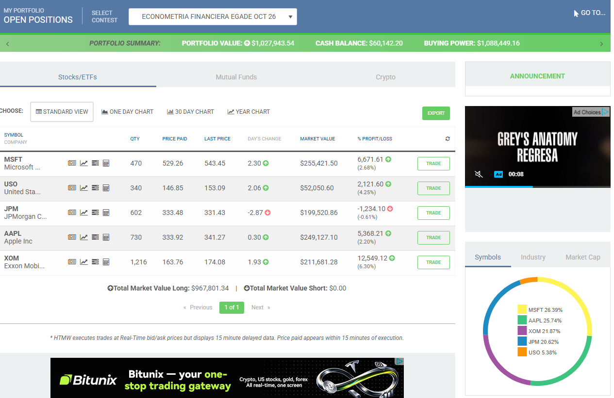
```

El portafolio tiene un valor total de $1,027,943.54, con cinco posiciones largas, las mismas de la Tarea 3, y ninguna posición en corto: MSFT (470 títulos, $255,421.50), AAPL (730 títulos, $249,127.10), XOM (1,216 títulos, $211,681.28), JPM (602 títulos, $199,520.86) y USO (340 títulos, $52,050.60). El efectivo disponible es de $60,142.20.

**Beta del portafolio contra el S&P 500.** Para medir qué tan expuesto está el portafolio a los movimientos del mercado se calcula su beta contra el S&P 500. La beta de un portafolio es el promedio de las betas de sus posiciones, ponderado por el peso de cada una en el valor total:

$$\beta_{portafolio} = \sum_{i} w_i \, \beta_i$$

donde $w_i$ es el peso de la posición $i$ (su valor entre el valor total del portafolio) y $\beta_i$ es su beta contra el S&P 500, estimada en la Parte 3 (beta cruda, igual en Bloomberg y en RStudio). El efectivo tiene beta cero, porque su valor no cambia con el mercado. En la siguiente tabla se calcula el peso de cada posición a partir de los valores de la imagen, y su beta se toma directamente de los modelos mt401 a mt408.

```{r portafolio-daniel-antes}
posiciones <- data.frame(
  Activo  = c("MSFT", "AAPL", "XOM", "JPM", "USO", "Efectivo"),
  Titulos = c(470, 730, 1216, 602, 340, NA),
  Valor   = c(255421.50, 249127.10, 211681.28, 199520.86, 52050.60, 60142.20))
posiciones$Peso <- posiciones$Valor / sum(posiciones$Valor) * 100
posiciones$Beta <- c(sapply(mods[c("MSFT", "AAPL", "XOM", "JPM", "USO")],
                            function(m) unname(coef(m)[2])), 0)
posiciones$Contribucion <- posiciones$Peso / 100 * posiciones$Beta
beta_antes <- sum(posiciones$Contribucion)

knitr::kable(posiciones, digits = c(0, 0, 2, 1, 3, 3), row.names = FALSE,
             format.args = list(big.mark = ","),
             col.names = c("Activo", "Títulos", "Valor (USD)", "Peso (%)", "Beta vs. S&P 500", "Peso × Beta"),
             caption = "Portafolio inicial al 13 de octubre de 2026")
```

La última columna es la contribución de cada posición a la beta del portafolio contra el S&P 500, y su suma es la beta del portafolio contra el S&P 500: `r round(beta_antes, 2)`. Es decir, ante un movimiento de 1% del S&P 500, el portafolio se mueve en promedio alrededor de `r round(beta_antes, 2)`%. Es menor a 1 por el peso de XOM y USO, cuyas betas contra el S&P 500 son bajas, y por el efectivo. MSFT (24.8%) y AAPL (24.2%) están prácticamente en el límite de 25% por posición, por lo que no admiten compras adicionales.

### 4.1.2 Estrategia

La estrategia realiza operaciones adicionales únicamente con acciones ya analizadas en esta actividad y en los modelos de las tareas anteriores. Se mantienen las cinco posiciones del portafolio y se agrega una venta en corto de Goldman Sachs (GS), acción que no forma parte del portafolio pero que se analizó en la Parte 3 (sección 3.6) y fue variable independiente de los modelos de JPM de la Tarea 2 (mt102) y de la Tarea 3 (mt302). Se utilizan distintos tipos de operación (venta, compra adicional, venta en corto y recompra), distintos tipos de orden (de mercado, límite y stop) y distintas vigencias (de un día e indefinida).

Las órdenes 1 a 3 se colocan el 13 de octubre de 2026, con el mercado cerrado, para ejecutarse a partir de la apertura del día siguiente. La orden 4 se coloca una vez ejecutada la venta en corto, porque protege una posición que antes no existe. El resultado de la estrategia depende de que las órdenes se ejecuten: las de mercado se ejecutan al precio de apertura, la orden límite solo si el precio llega al nivel indicado, y la orden stop solo si GS sube hasta su nivel.

| # | Operación | Acción | Tipo de orden | Vigencia | Títulos |
|---|---|---|---|---|---|
| 1 | Venta parcial | USO | Mercado | Un día | 170 |
| 2 | Compra adicional | XOM | Límite a $174.00 | Un día | 100 |
| 3 | Venta en corto (*short*) | GS | Mercado | Un día | 55 |
| 4 | Recompra (*cover*) de protección | GS | Stop a 8% sobre el precio de ejecución de la orden 3 | Indefinida | 55 |

La justificación de cada operación es la siguiente:

1. **Venta parcial de USO.** USO es la posición con menor sustento en el análisis: su beta contra el S&P 500 no es estadísticamente significativa (valor p de 0.154), tiene la mayor variación no explicada por el mercado de las ocho regresiones (desviación estándar del error de 2.703) y está correlacionada con XOM en todas las versiones analizadas (entre 0.519 y 0.715), por lo que duplica la exposición a energía. No se vende completa porque, de julio a octubre de 2026, su beta contra el S&P 500 fue de −2.647 (sección 3.11): en los meses recientes funcionó como cobertura frente a las caídas del mercado. Vender la mitad equilibra ambos resultados.
2. **Compra adicional de XOM.** Reemplaza parte de la exposición a energía que se reduce con la venta de USO, pero con menor riesgo propio (desviación estándar del error de 1.604, contra 2.703 de USO). Con la compra, XOM pasaría de 20.6% a cerca de 22.3% del portafolio, por debajo del límite de 25%. Se usa una orden límite a $174.00, cercana al último precio ($174.08), para no pagar un precio mayor si el mercado abre al alza; si el precio no llega a ese nivel, la orden vence sin ejecutarse.
3. **Venta en corto de GS.** No es una apuesta contra Goldman Sachs, sino una cobertura del riesgo de mercado del portafolio. GS es la acción con el $R^2$ más alto (0.561), es decir, la que más depende del S&P 500, lo que la hace la cobertura más confiable entre las ocho acciones; además, su correlación de 0.740 con JPM cubre en parte la posición en el sector financiero. La cobertura tiene un costo: si el mercado sube, la venta en corto pierde y reduce las ganancias del resto del portafolio; a cambio, si el mercado cae, amortigua las pérdidas. El tamaño es pequeño (cerca de 5% del portafolio) para limitar este efecto.
4. **Recompra de protección de GS.** En una venta en corto, la pérdida no tiene un límite teórico si el precio sube. La orden stop cierra automáticamente la posición si GS sube 8% sobre el precio al que se ejecutó la venta en corto, de modo que la pérdida máxima de la posición queda acotada. El margen de 8% evita que la orden se active con un movimiento normal de un día: el 13 de octubre, GS se movió entre $891.01 y $931.00, un rango superior a 4%. Se coloca con vigencia indefinida (*Good til Cancel*), porque la protección debe mantenerse activa mientras exista la posición en corto. Por su naturaleza, esta orden normalmente no se ejecuta; solo se activa si el precio sube de forma importante.

**Regla de seguimiento para la orden límite.** Si la orden 2 vence sin ejecutarse, se vuelve a colocar con el mismo precio límite de $174.00, pero con vigencia indefinida. No se sube el precio límite para perseguir el precio de mercado: el criterio de compra se mantiene, y la orden queda activa hasta que XOM llegue a ese nivel o hasta que se cancele.

**Efecto estimado en el portafolio.** La siguiente tabla estima cómo quedaría el portafolio si las órdenes 1 a 3 se ejecutaran a los precios de referencia del 13 de octubre (USO a $153.09, XOM a $174.00 y GS a $891.91). La venta en corto se registra con valor negativo, porque gana cuando el precio baja, y el efectivo aumenta con lo obtenido de las ventas y se reduce con la compra.

```{r portafolio-daniel-estimado}
p_uso <- 153.09; p_xom <- 174.00; p_gs <- 891.91

estimado <- data.frame(
  Activo = c("MSFT", "AAPL", "XOM", "JPM", "USO", "GS (corto)", "Efectivo"),
  Valor  = c(255421.50, 249127.10,
             211681.28 + 100 * p_xom,
             199520.86,
             52050.60 - 170 * p_uso,
             -55 * p_gs,
             60142.20 + 170 * p_uso - 100 * p_xom + 55 * p_gs))
estimado$Peso <- estimado$Valor / sum(estimado$Valor) * 100
estimado$Beta <- c(sapply(mods[c("MSFT", "AAPL", "XOM", "JPM", "USO", "GS")],
                          function(m) unname(coef(m)[2])), 0)
estimado$Contribucion <- estimado$Peso / 100 * estimado$Beta
beta_estimada <- sum(estimado$Contribucion)

knitr::kable(estimado, digits = c(0, 2, 1, 3, 3), row.names = FALSE,
             format.args = list(big.mark = ","),
             col.names = c("Activo", "Valor (USD)", "Peso (%)", "Beta vs. S&P 500", "Peso × Beta"),
             caption = "Portafolio estimado después de las operaciones 1 a 3")
```

Si las órdenes se ejecutan a estos precios, la beta del portafolio contra el S&P 500 bajaría de `r round(beta_antes, 2)` a `r round(beta_estimada, 2)`: el portafolio se vuelve más defensivo frente a los movimientos del mercado, sin modificar AAPL ni MSFT, que ya están en el límite de 25%. El valor total del portafolio no cambia por las operaciones, solo su composición. El resultado real se verifica con el portafolio final (sección 4.1.5).

### 4.1.3 Órdenes colocadas

En esta sección se presentan las órdenes tal como se colocaron en HowMarketsWork. Cada imagen muestra la pantalla de la orden antes de confirmarla: el tipo de operación (*Action*), la acción (*Symbol*), el número de títulos (*Quantity*), el tipo de orden (*Type*), el precio límite o stop cuando aplica (*Limit/Stop Price*), la vigencia de la orden (*Order Term*) y la cotización de la acción al momento de colocarla. En la parte inferior, el simulador muestra un resumen de la orden con la comisión de $10.00 por operación y el monto estimado.

#### Órdenes del 13 de octubre de 2026

**Orden 1: venta parcial de USO.** En la siguiente imagen se observa la orden de venta (*Sell*) de 170 títulos de USO a mercado (*Market*), con vigencia de un día (*Good for Day*). El último precio de USO era de $153.09 y el monto estimado de la venta, de $26,017.00, corresponde a 170 títulos al precio de compra del mercado (*bid*) de $153.10, menos la comisión.

```{r hmw-orden1, echo=FALSE, out.width="90%"}

```

**Orden 2: compra adicional de XOM.** En la siguiente imagen se observa la orden de compra (*Buy*) de 100 títulos de XOM con orden límite (*Limit*) a $174.00 y vigencia de un día. El último precio de XOM era de $174.08 y el precio de venta del mercado (*ask*) de $174.15, ligeramente por arriba del límite: la orden solo se ejecuta si XOM se ofrece a $174.00 o menos. El costo estimado es de $17,410.00, incluida la comisión.

```{r hmw-orden2, echo=FALSE, out.width="90%"}
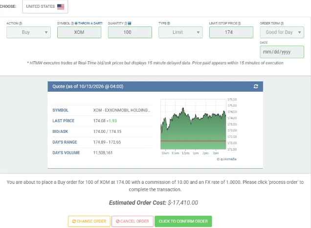
```

**Orden 3: venta en corto de GS.** En la siguiente imagen se observa la orden de venta en corto (*Short*) de 55 títulos de GS a mercado, con vigencia de un día. El último precio de GS era de $891.91 y el monto estimado, de $49,077.50, corresponde a 55 títulos al precio *bid* de $892.50, menos la comisión, lo que representa cerca de 4.8% del valor del portafolio.

```{r hmw-orden3, echo=FALSE, out.width="90%"}
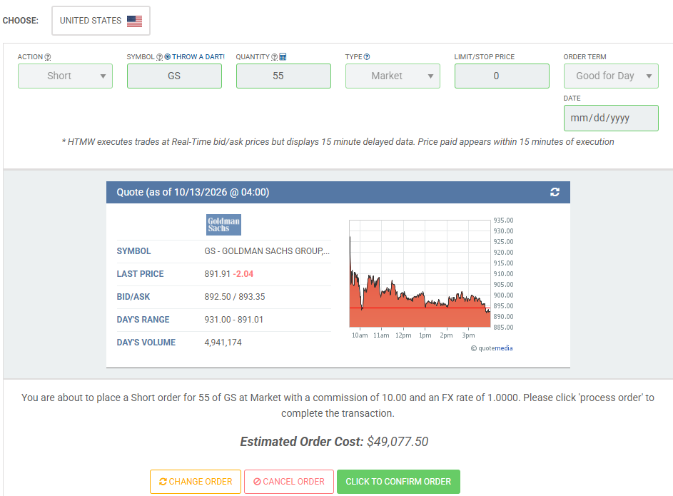
```

**Órdenes pendientes al 13 de octubre.** En la siguiente imagen se observa la lista de órdenes del simulador después de colocar las tres órdenes anteriores. Las tres aparecen con fecha del 13 de octubre de 2026 y sin precio de ejecución (*Trade Price*), y conservan las opciones para cancelarlas o editarlas (*Cancel* y *Edit*), lo que confirma que quedaron abiertas en espera de la apertura del mercado.

```{r hmw-pendientes, echo=FALSE, out.width="90%"}
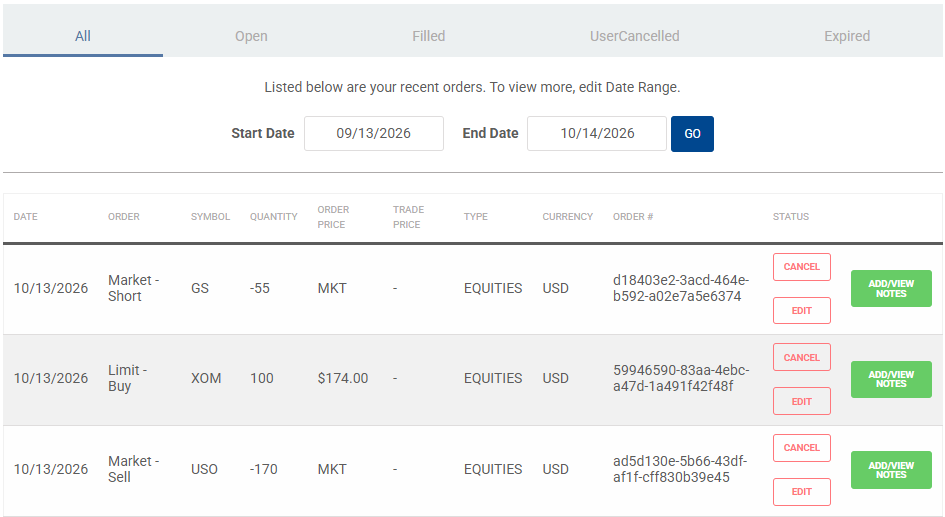
```

#### Órdenes del 14 de octubre de 2026

El 14 de octubre, a la apertura, se ejecutaron la venta de USO y la venta en corto de GS, y la orden límite de XOM venció sin ejecutarse (el detalle de la ejecución se presenta en la sección 4.1.4). Con base en esos resultados, ese día se colocaron dos órdenes nuevas, de acuerdo con la estrategia de la sección 4.1.2.

**Orden 4: recompra de protección de GS.** Una vez ejecutada la venta en corto a $879.00, se colocó la orden de protección. En la siguiente imagen se observa la orden de recompra (*Cover*) de 55 títulos de GS con orden stop (*Stop*) a $949.00, que equivale a 8% por arriba del precio de ejecución de la venta en corto ($879.00 × 1.08 = $949.32, redondeado a $949.00). Su vigencia es indefinida (*Good til Cancel*): la protección se mantiene activa todos los días mientras exista la posición en corto. Al momento de colocarla, el último precio de GS era de $878.72, por lo que la orden solo se activaría si GS sube cerca de 8% desde ese nivel.

```{r hmw-orden4, echo=FALSE, out.width="90%"}
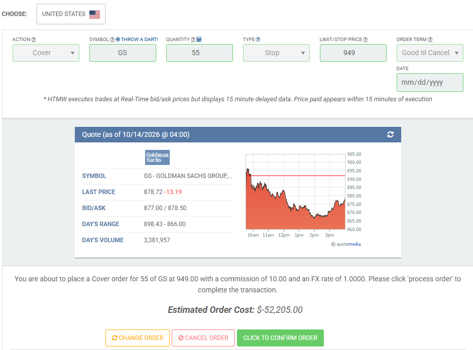
```

**Orden 5: nueva compra límite de XOM.** De acuerdo con la regla de seguimiento de la sección 4.1.2, la orden límite de XOM que venció se volvió a colocar con el mismo precio límite y vigencia indefinida. En la siguiente imagen se observa la orden de compra (*Buy*) de 100 títulos de XOM con orden límite a $174.00 y vigencia *Good til Cancel*. Al momento de colocarla, XOM cotizaba en $177.01, por arriba del límite, por lo que la orden solo se ejecutará si el precio baja a $174.00.

```{r hmw-orden5, echo=FALSE, out.width="90%"}
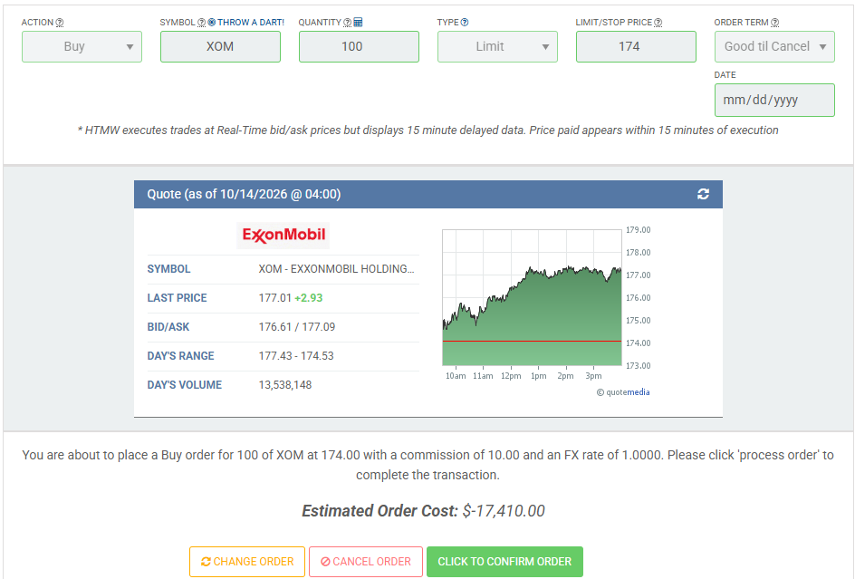
```

### 4.1.4 Ejecución de las órdenes

En la siguiente imagen se observa la lista de órdenes del simulador al cierre del 14 de octubre de 2026. Incluye las tres órdenes colocadas el 13 de octubre, con su resultado, y las dos órdenes colocadas el 14 de octubre, que siguen abiertas. La columna *Trade Price* muestra el precio al que se ejecutó cada orden y la columna *Status* su estado: ejecutada (*Filled*), vencida (*Expired*) o abierta, cuando conserva las opciones para cancelarla o editarla (*Cancel* y *Edit*).

```{r hmw-ordenes-14oct, echo=FALSE, out.width="90%"}
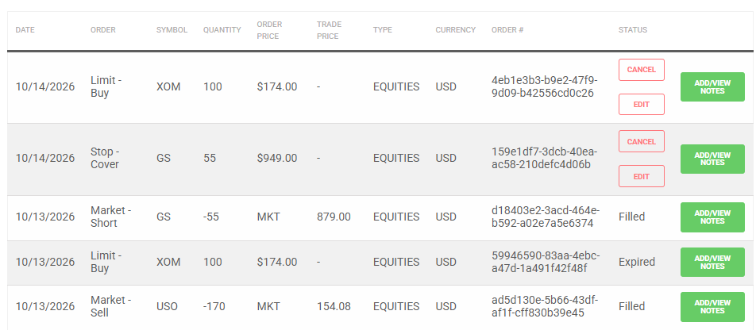
```

La siguiente tabla resume el resultado de cada orden al 14 de octubre de 2026:

| # | Operación | Acción | Títulos | Precio de referencia (13 oct) | Resultado | Precio de ejecución |
|---|---|---|---|---|---|---|
| 1 | Venta parcial (mercado) | USO | 170 | $153.09 | Ejecutada | $154.08 |
| 2 | Compra adicional (límite a $174.00, un día) | XOM | 100 | $174.08 | Vencida | — |
| 3 | Venta en corto (mercado) | GS | 55 | $891.91 | Ejecutada | $879.00 |
| 4 | Recompra de protección (stop a $949.00, indefinida) | GS | 55 | — | Abierta | — |
| 5 | Compra adicional (límite a $174.00, indefinida) | XOM | 100 | — | Abierta | — |

El resultado de cada orden es el siguiente:

- **Orden 1 (USO):** se ejecutó a la apertura a $154.08, $0.99 por arriba del precio de referencia, por lo que la venta obtuvo $26,183.60 después de la comisión ($168.30 más de lo estimado).
- **Orden 2 (XOM):** venció sin ejecutarse. Durante el 14 de octubre, XOM no bajó del límite de $174.00: su precio mínimo del día fue de $174.53 y cerró en $177.01. Es el comportamiento esperado de una orden límite: protege el precio máximo de compra, a cambio de no garantizar la ejecución.
- **Orden 3 (GS):** se ejecutó a la apertura a $879.00, $12.91 por debajo del precio de referencia, porque GS abrió a la baja. Al cierre del día, GS cotizaba en $878.72, por lo que la posición en corto registraba una ganancia de $15.40.
- **Órdenes 4 y 5:** quedaron abiertas con vigencia indefinida. La orden stop solo se activará si GS sube a $949.00, y la nueva compra límite solo si XOM baja a $174.00. Su resultado depende del comportamiento del mercado en los días siguientes.

Como verificación, el efectivo del portafolio cuadra con las operaciones ejecutadas: $60,142.20 iniciales, más $26,183.60 de la venta de USO, menos $10.00 de comisión de la venta en corto, dan $86,315.80, que es el saldo que muestra el simulador en la sección 4.1.5.

### 4.1.5 Portafolio final

En la siguiente imagen se observa el portafolio en HowMarketsWork al cierre del 14 de octubre de 2026, después de la ejecución de las órdenes. El portafolio tiene ahora cinco posiciones largas (USO, XOM, JPM, MSFT y AAPL) y una posición en corto (GS, con −55 títulos). En la parte superior se muestran el valor total del portafolio ($1,030,714.22), el efectivo ($86,315.80) y el poder de compra.

```{r hmw-daniel-despues, echo=FALSE, out.width="95%"}
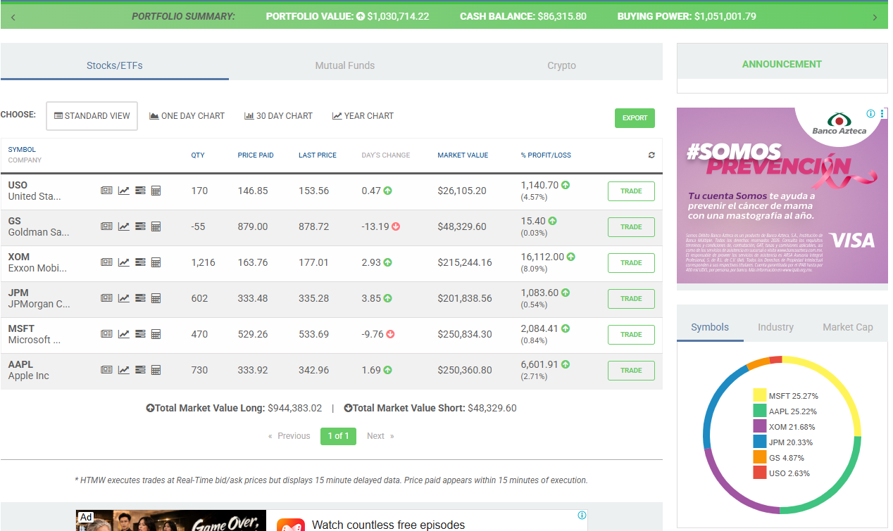
```

En la imagen se observa el efecto de las órdenes ejecutadas: USO pasó de 340 a 170 títulos, GS aparece con −55 títulos al precio de ejecución de $879.00, y XOM conserva sus 1,216 títulos, porque la orden de compra límite no se ejecutó.

**Beta del portafolio final.** La beta del portafolio contra el S&P 500 se calcula igual que en la sección 4.1.1, como el promedio de las betas contra el S&P 500 de las posiciones ponderado por su peso. Hay una diferencia en la presentación de la venta en corto: el simulador muestra el efectivo sin incluir lo obtenido por la venta en corto ($879.00 × 55 = $48,345.00), y suma al valor del portafolio solo la ganancia o pérdida de esa posición. Para calcular los pesos de forma consistente con la sección 4.1.2, la venta en corto se registra con su valor de mercado en negativo y lo obtenido por ella se suma al efectivo. Con este registro, la suma de las posiciones es igual al valor del portafolio que muestra el simulador.

```{r portafolio-daniel-despues}
final <- data.frame(
  Activo  = c("MSFT", "AAPL", "XOM", "JPM", "USO", "GS (corto)", "Efectivo"),
  Titulos = c(470, 730, 1216, 602, 170, -55, NA),
  Valor   = c(250834.30, 250360.80, 215244.16, 201838.56, 26105.20,
              -48329.60, 86315.80 + 55 * 879.00))
final$Peso <- final$Valor / sum(final$Valor) * 100
final$Beta <- c(sapply(mods[c("MSFT", "AAPL", "XOM", "JPM", "USO", "GS")],
                       function(m) unname(coef(m)[2])), 0)
final$Contribucion <- final$Peso / 100 * final$Beta
beta_despues <- sum(final$Contribucion)

knitr::kable(final, digits = c(0, 0, 2, 1, 3, 3), row.names = FALSE,
             format.args = list(big.mark = ","),
             col.names = c("Activo", "Títulos", "Valor (USD)", "Peso (%)",
                           "Beta vs. S&P 500", "Peso × Beta"),
             caption = "Portafolio final al 14 de octubre de 2026")
```

La suma de los valores de la tabla es de $`r format(round(sum(final$Valor), 2), big.mark = ",", nsmall = 2)`, igual al valor del portafolio que muestra el simulador. La beta del portafolio contra el S&P 500 es de `r round(beta_despues, 2)`.

**Comparación antes y después.** La siguiente tabla compara el peso de cada posición en el portafolio inicial (sección 4.1.1) y en el portafolio final.

```{r comparacion-antes-despues}
comparacion <- data.frame(
  Activo  = final$Activo,
  Antes   = c(posiciones$Peso[1:5], 0, posiciones$Peso[6]),
  Despues = final$Peso)
comparacion$Cambio <- comparacion$Despues - comparacion$Antes

knitr::kable(comparacion, digits = 1, row.names = FALSE,
             col.names = c("Activo", "Peso inicial (%)", "Peso final (%)", "Cambio (puntos)"),
             caption = "Peso de cada posición antes y después de las operaciones")
```

La comparación muestra los resultados de la estrategia:

- **La beta del portafolio contra el S&P 500 bajó de `r round(beta_antes, 2)` a `r round(beta_despues, 2)`**, como se había estimado en la sección 4.1.2. El portafolio quedó más defensivo frente a los movimientos del mercado. La reducción se debe principalmente a la venta en corto de GS, que resta exposición al mercado, y al mayor peso del efectivo.
- **La exposición a energía se redujo**: USO pasó de 5.1% a 2.5% del portafolio. Como la compra de XOM no se ejecutó, esa exposición no se reemplazó; la orden límite sigue abierta y, si se ejecuta, XOM aumentará su peso.
- **El efectivo aumentó** de 5.9% a 13.1% del portafolio, por la venta de USO y por lo obtenido de la venta en corto.

Sobre el límite de 25% por posición: en la gráfica de la derecha de la imagen, el simulador muestra a MSFT (25.27%) y AAPL (25.22%) ligeramente por arriba de 25%. Esto se debe a que el simulador calcula esos porcentajes sobre la suma de las posiciones largas y cortas, y no sobre el valor del portafolio. Medidos sobre el valor del portafolio, como en la tabla anterior, ambas representan 24.3%, por debajo del límite. Además, no se compraron títulos adicionales de ninguna de las dos: su peso cambió solo por el movimiento de sus precios.

El valor del portafolio pasó de $1,027,943.54 a $1,030,714.22 entre el 13 y el 14 de octubre de 2026. Esta variación refleja tanto las operaciones como el movimiento de los precios de mercado en un solo día, por lo que no debe interpretarse como el resultado de la estrategia, cuyo objetivo es reducir la exposición del portafolio al mercado y no obtener un rendimiento en el corto plazo.

## 4.2 Operaciones en HowMarketsWork – Bárbara Martínez Flores

### 4.2.1 Portafolio inicial

### 4.2.2 Estrategia

### 4.2.3 Órdenes y ejecución

### 4.2.4 Portafolio final

# Parte 5. Preguntas del capítulo 16 de Gujarati (16.1 a 16.4)

En esta parte se responden las preguntas 16.1 a 16.4 del capítulo 16 de Gujarati y Porter, *Econometría* (5a. edición), "Modelos de regresión con datos de panel". Para hacer concretas las respuestas, cada una se ilustra con los datos de esta actividad: los rendimientos diarios de las ocho acciones del 2 de enero de 2025 al 12 de octubre de 2026.

**16.1 ¿Cuáles son las características especiales de a) los datos de corte transversal, b) las series de tiempo y c) los datos de panel?**

a) **Datos de corte transversal.** Son observaciones de varias unidades (individuos, empresas, países) en un mismo momento. Su característica principal es la heterogeneidad entre unidades: cada una puede tener un tamaño o un comportamiento muy distinto, lo que suele provocar problemas de heteroscedasticidad. En esta actividad, un corte transversal serían los rendimientos de las ocho acciones en un solo día; por ejemplo, el 9 de abril de 2025, cuando el S&P 500 subió 9.52%, cada acción reaccionó de manera distinta.

b) **Series de tiempo.** Son observaciones de una sola unidad a lo largo del tiempo. Sus características principales son que las observaciones suelen depender de las anteriores (autocorrelación), que la serie puede no ser estacionaria y que su comportamiento puede cambiar entre periodos. Cada regresión de la Parte 3 es un modelo de series de tiempo: por ejemplo, los 444 rendimientos diarios de AAPL contra los del S&P 500. La sección 3.11 muestra uno de estos problemas: las betas contra el S&P 500 estimadas para julio a octubre de 2026 difieren de forma importante de las del periodo completo.

c) **Datos de panel.** Combinan ambas dimensiones: las mismas unidades se observan a lo largo del tiempo. Los datos de esta actividad forman un panel de 8 acciones × 444 días = 3,552 observaciones, y es un panel balanceado, porque todas las acciones tienen las mismas fechas (como se verificó en la sección 1.1). De acuerdo con Gujarati, los datos de panel permiten tomar en cuenta la heterogeneidad entre unidades, ofrecen más observaciones, más variabilidad y más grados de libertad, y son más adecuados para estudiar la dinámica del cambio. A cambio, combinan los problemas de ambos tipos de datos: heteroscedasticidad entre unidades, autocorrelación en el tiempo y, además, correlación entre unidades en un mismo momento. Esta última es muy clara en esta actividad: la matriz de correlación de la Parte 2 muestra que los rendimientos de las acciones de un mismo sector se mueven juntos el mismo día (por ejemplo, XOM y CVX, con una correlación de 0.851).

**16.2 ¿Qué se quiere dar a entender con modelo de efectos fijos (MEF)? Como los datos de panel presentan las dos dimensiones de tiempo y espacio, ¿cómo es que el MEF permite ambas dimensiones?**

El modelo de efectos fijos permite que el intercepto sea distinto para cada unidad, para reconocer que cada una tiene características propias que no se observan. Se llama "fijo" porque el intercepto de cada unidad no cambia con el tiempo. Las pendientes, en cambio, se suponen iguales para todas las unidades. Aplicado a esta actividad, sería:

$$R_{it} = \alpha_i + \beta \, R_{SPX,t} + u_{it}$$

donde $R_{it}$ es el rendimiento de la acción $i$ en el día $t$, $\alpha_i$ es el intercepto propio de cada acción y $\beta$ es una beta contra el S&P 500 común a las ocho. En la práctica, el intercepto de cada unidad se introduce con variables dicótomas (una por acción).

El MEF permite ambas dimensiones porque, además de las variables dicótomas por unidad (efecto individual), pueden incluirse variables dicótomas por periodo (efecto temporal), que recogen factores que afectan a todas las unidades en un mismo momento. Esta actividad muestra un límite de esa opción: el rendimiento del S&P 500 es el mismo para las ocho acciones en un día dado, por lo que un conjunto completo de variables dicótomas por día sería perfectamente colineal con él, y el modelo no podría estimar la beta contra el S&P 500. Además, la Parte 3 muestra que el supuesto de una pendiente común no se cumple en estos datos: las betas contra el S&P 500 van de −0.177 (USO) a 1.947 (NVDA). Un MEF con una sola beta sería inadecuado aquí, y tendría que permitir pendientes distintas por acción.

**16.3 ¿Qué se quiere dar a entender con modelo con componentes del error (MCE)? ¿En qué difiere del MEF? ¿Cuándo resulta apropiado el MCE, y cuándo el MEF?**

En el modelo con componentes del error, también llamado modelo de efectos aleatorios, el intercepto de cada unidad no se trata como un parámetro fijo, sino como una variable aleatoria alrededor de una media común: $\alpha_i = \alpha + \varepsilon_i$. La diferencia individual $\varepsilon_i$ pasa a formar parte del término de error, que se compone de dos partes: $w_{it} = \varepsilon_i + u_{it}$. La idea es que las unidades de la muestra provienen de una población más grande que comparte un intercepto promedio.

Las diferencias con el MEF son dos. Primero, el MEF estima un intercepto para cada unidad (con la consecuente pérdida de grados de libertad), mientras que el MCE solo estima el intercepto promedio y la varianza de $\varepsilon_i$. Segundo, y más importante, el MCE requiere que el componente individual $\varepsilon_i$ no esté correlacionado con las variables explicativas; el MEF no lo requiere.

De acuerdo con Gujarati, el MCE es apropiado cuando las unidades son una muestra aleatoria de una población más grande y su componente individual no está correlacionado con las variables explicativas; el MEF lo es cuando sí existe esa correlación o cuando las unidades no son una muestra aleatoria. Si el número de periodos es grande y el de unidades pequeño, la diferencia entre ambos suele ser pequeña. Formalmente, la elección se hace con la prueba de Hausman: si se rechaza la hipótesis nula de que no hay diferencia entre ambos estimadores, se prefiere el MEF. En esta actividad, las ocho acciones no son una muestra aleatoria del mercado: se eligieron deliberadamente por su sector y por formar parte del portafolio. Además, el panel tiene pocas unidades (8) y muchos periodos (444). Por ambas razones, el MEF sería el más adecuado.

**16.4 ¿Hay diferencia entre los modelos de mínimos cuadrados con variables dicótomas (MCVD), estimados dentro de grupos y primeras diferencias?**

Los tres son formas de estimar un modelo de efectos fijos, es decir, de controlar las características propias de cada unidad que no cambian con el tiempo. Difieren en cómo lo hacen:

- **MCVD:** incluye una variable dicótoma por unidad y estima directamente el intercepto de cada una. Su desventaja es que pierde un grado de libertad por cada variable dicótoma, lo que importa cuando hay muchas unidades.
- **Estimador dentro de grupos (DG):** a cada variable le resta su promedio por unidad, con lo que el efecto fijo desaparece. Las pendientes son las mismas que las de MCVD, pero el intercepto de cada unidad no se estima directamente. En esta actividad equivaldría a restar a los rendimientos de cada acción su rendimiento diario promedio del periodo.
- **Primeras diferencias:** a cada observación le resta la del periodo anterior de la misma unidad, lo que también elimina el efecto fijo. Cada unidad pierde su primera observación. La idea es parecida a la del paso de precios a rendimientos en la sección 1.1, en el que cada serie pasó de 445 precios a 444 rendimientos. Si el error original no está autocorrelacionado, el error en diferencias sí lo está.

Tanto el estimador dentro de grupos como el de primeras diferencias eliminan, junto con el efecto fijo, cualquier variable explicativa que no cambie con el tiempo. Además, según Gujarati, los estimadores de primeras diferencias y de efectos fijos coinciden cuando solo hay dos periodos, pero difieren cuando hay más. Con 444 días por acción, en esta actividad los resultados de primeras diferencias no coincidirían con los de MCVD y dentro de grupos.
